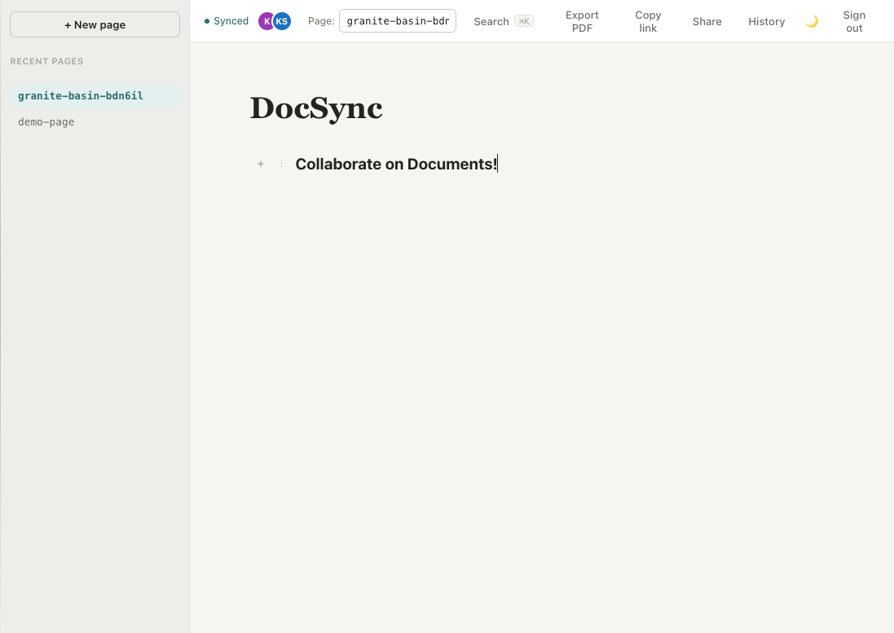
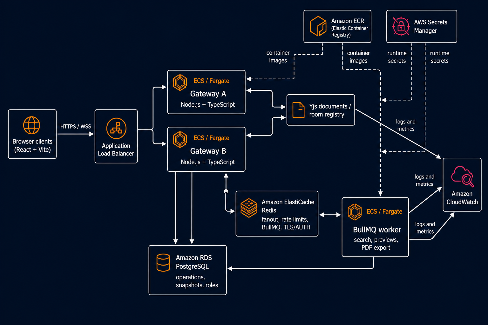

# DocSync

A shared workspace for notes, source code, and visual canvases. Multiple people can edit the same page, see live presence and cursors, discuss changes in comments, restore earlier versions, and export a page as a PDF.

  

---

## Capabilities

- Block-based pages with headings, rich text, code, and canvas blocks
- Concurrent editing via Yjs CRDT synchronization
- CodeMirror 6 editor blocks and tldraw canvas blocks
- Live presence, cursors, comments, mentions, search, and link previews
- Version history with restore from a durable operation log
- Owner, editor, and viewer access controls
- Background jobs for search indexing, link previews, and PDF export
- Rate limiting, structured logging, metrics, and distributed tracing

## Architecture

The synchronization path is small: clients exchange Yjs updates through a WebSocket gateway, Postgres holds durable history, and Redis propagates updates between gateway replicas. Authorization is checked on the server before any mutation is accepted.

  

The same design runs in two environments. Locally, Nginx sits in front of two gateway containers, Postgres, and Redis, all managed by Docker Compose. On AWS, an Application Load Balancer sits in front of two ECS/Fargate gateway tasks backed by RDS PostgreSQL (Single-AZ) and ElastiCache Redis, with images pulled from ECR, secrets from Secrets Manager, and logs and metrics sent to CloudWatch. Both environments run the identical gateway code and the same Postgres-then-Redis write order.

### Data flow for an edit

~~~mermaid
sequenceDiagram
  participant A as Browser A
  participant G as WebSocket gateway
  participant P as Postgres
  participant R as Redis
  participant B as Browser B
  A->>G: Yjs update + awareness
  G->>G: authenticate, authorize, validate
  G->>P: append operation / snapshot
  G->>R: publish page update
  R-->>G: fan out to other replicas
  G-->>B: apply Yjs update
~~~

An accepted edit is authenticated and authorized at the WebSocket boundary, appended to Postgres, applied to the local Yjs document, and only then published through Redis to the other gateway. Durable history is always written before fanout, which keeps replay and recovery consistent.

## Some Notes

- Two gateway instances share document state without sticky sessions
- Accepted edits are written to Postgres before being shared with other gateways; snapshots and replay support recovery
- Authenticated 25/50/100-client collaboration tests run through the real WebSocket path
- AWS 100-client run achieved 100/100 convergence with 5.645 s p95 and 5.979 s p99 propagation latency
- 108 server tests cover authentication, RBAC, persistence, fanout, recovery, and convergence

## Technology

| Area | Technologies |
| --- | --- |
| Frontend | React 18, Vite, CodeMirror 6, tldraw, Yjs, y-codemirror.next |
| Backend | Node.js 24 CI target (20+ supported), TypeScript, ws, Yjs, y-protocols, lib0 |
| Data and jobs | PostgreSQL, Redis, ioredis, BullMQ, PDFKit |
| Security | JWT, Node scrypt, origin allowlists, RBAC, parameterized SQL, Redis-backed rate limits |
| Observability | Prometheus, Grafana, OpenTelemetry OTLP HTTP, Jaeger, Pino structured logging |
| Local delivery | Docker Compose, Nginx, dedicated gateway and worker services |
| Cloud delivery | AWS ALB, ECS/Fargate, ECR, RDS PostgreSQL, ElastiCache Redis, Secrets Manager, CloudWatch, IAM |
| Verification | Vitest, pg-mem, ioredis-mock, Node/Yjs benchmark clients, k6, Docker fault injection, GitHub Actions |

## Local development

**Requirements:** Node.js 24 recommended (Node.js 20+ remains supported) and pnpm.

For the complete local topology (Postgres, Redis, Nginx, two gateways, worker, Prometheus, Grafana, and Jaeger):

~~~bash
cp .env.example .env
docker compose up --build -d
~~~

For a disposable client/server demo without external services:

~~~bash
pnpm install
NODE_ENV=development ALLOW_INSECURE_LOCAL_AUTH_BYPASS=true pnpm dev:server
pnpm dev:client
~~~

Open [http://localhost:5173](http://localhost:5173) in two tabs and use the same `?page=` value to edit one document together. The bypass is only for local development. Normal startup requires configured Postgres, Redis, JWT, and allowed-origin settings.

## Deployment

### Render preview

`render.yaml` defines a low-cost preview with a Node API, static React client, PostgreSQL, and Redis. After creating the Blueprint, set the API's allowed origin to the client URL and the client's WebSocket URL to the API URL. Keep JWT, database, and Redis credentials in Render-managed environment variables.

### AWS staging

The repository includes Terraform for a repeatable, cost-bounded AWS topology using an ALB, two ECS/Fargate gateways, RDS PostgreSQL, ElastiCache Redis, ECR, Secrets Manager, CloudWatch, and a BullMQ worker. The measured staging environment was deployed in us-east-2 for benchmark and failover evidence.

## Validation

~~~bash
pnpm build
pnpm test
~~~

The test suite covers persistence adapters, authentication, permissions, WebSocket behavior, rate limiting, concurrent edits, Redis recovery, and worker accounting. The benchmark clients exercise authenticated binary Yjs updates through the two-gateway topology at 25, 50, and 100 concurrent clients.

## Project layout

~~~text
packages/shared     Shared document schema and WebSocket message types
packages/server      WebSocket gateway, auth/RBAC, persistence, jobs, and telemetry
packages/client      React editor, presence, comments, history, and export controls
loadtest/            k6 HTTP and WebSocket scenarios
infra/aws/           Terraform AWS staging topology
prometheus/          Prometheus scrape and alert rules
scripts/             Benchmark, integration, backup, chaos, and deployment tooling
render.yaml          Render deployment blueprint
docker-compose.yml   Local multi-service development topology
~~~

## License

MIT. See [LICENSE](LICENSE).
</content>
