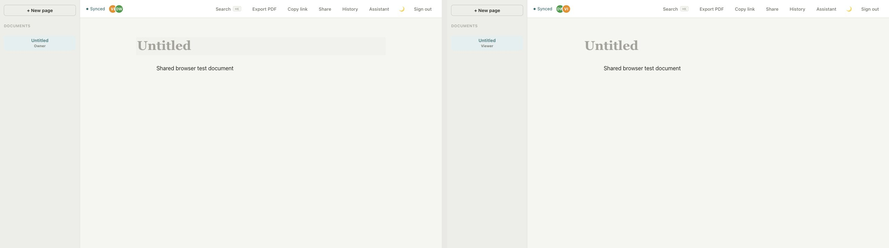

# DocSync

DocSync is a shared workspace for notes, source code, and visual canvases.
Work together on the same page, share it with clear roles, ask the built-in
assistant for help, review suggested edits before applying them, and return to
earlier versions when you need to.

  

  

---

## Features

- **Blocks and canvases.** Combine headings, rich text, checklists, bullet lists,
  code blocks, and tldraw canvases on one page. Press Enter after a code or
  canvas block to continue with a normal paragraph.
- **Real-time collaboration.** See live presence, cursors, comments, mentions,
  search, link previews, and updates from other people as they arrive.
- **Sharing and permissions.** New pages are private. Invite people as owners,
  editors, or viewers, send email invitations, and show online accept/decline
  notifications. Viewer permissions are enforced by the server, not only by
  the interface.
- **Gemini Document assistant.** Ask questions about the current page or
  describe a change in a normal chat. Suggested edits are shown as a readable
  diff and require approval before they change the document.
- **Version history.** Rapid edits are grouped into
  30-second entries, compares an entry with the previous version inline, and
  restores an older version without deleting the history that came after it.
- **Exports and background work.** PDF export, search indexing,
  and link previews while the editor stays responsive.

## Architecture

The editor is a React/Vite client connected to a Node WebSocket gateway. Pages
are stored in Postgres, Redis carries updates between gateway replicas, and a
separate worker handles background jobs. Every change is checked, saved, and
then shared with the other connected clients.

  

The same design runs in two environments. Locally, Nginx sits in front of two
gateway containers, Postgres, and Redis, all managed by Docker Compose. On AWS,
an Application Load Balancer sits in front of two ECS/Fargate gateway tasks
backed by RDS PostgreSQL (Single-AZ) and ElastiCache Redis, with images pulled
from ECR, secrets from Secrets Manager, and logs and metrics sent to CloudWatch.
Both environments run the same gateway code and save each change before
sharing it with the other replica.

### Data flow for an edit

~~~mermaid
sequenceDiagram
  participant A as Browser A
  participant G as WebSocket gateway
  participant P as Postgres
  participant R as Redis
  participant B as Browser B
  A->>G: Yjs update + awareness
  G->>G: authenticate, authorize, validate
  G->>P: append operation / snapshot
  G->>R: publish page update
  R-->>G: fan out to other replicas
  G-->>B: apply Yjs update
~~~

Each edit is checked at the WebSocket boundary, saved to Postgres, applied to
the local page, and then sent through Redis to the other gateway. This keeps
reconnect, replay, and version restore consistent across replicas.

## Verification

The repository includes repeatable local and cloud test paths. The short-lived
AWS profile used two gateways, one worker, one Single-AZ database, and one
Redis node in us-east-2; it was deprovisioned after testing.

- Authenticated 25/50/100-client collaboration tests run through the full
  WebSocket path across two gateways.
- The bounded AWS 100-client run reached 100/100 convergence with 5.645 s p95
  and 5.979 s p99 propagation latency.
- 113 server tests cover authentication, roles, persistence, fanout, recovery,
  invitations, and concurrent editing; assistant tests cover provider errors,
  fresh document state, and stale suggestions.
- Browser checks cover private pages, invitation acceptance, live presence,
  viewer write rejection, history, PDF export, and approved assistant edits.

## Technology

| Area | Technologies |
| --- | --- |
| Frontend | React 18, Vite, CodeMirror 6, tldraw, Yjs, y-codemirror.next |
| Backend | Node.js 24, TypeScript, ws, Yjs, y-protocols, lib0 |
| Data and jobs | PostgreSQL, Redis, ioredis, BullMQ, PDFKit |
| Security | JWT, Node scrypt, origin allowlists, RBAC, parameterized SQL, Redis-backed rate limits |
| Observability | Prometheus, Grafana, OpenTelemetry OTLP HTTP, Jaeger, Pino structured logging |
| Local delivery | Docker Compose, Nginx, dedicated gateway and worker services |
| Cloud delivery | AWS ALB, ECS/Fargate, ECR, RDS PostgreSQL, ElastiCache Redis, Secrets Manager, CloudWatch, IAM |
| Verification | Vitest, pg-mem, ioredis-mock, Node/Yjs benchmark clients, k6, Docker fault injection, GitHub Actions |

## Local development

**Requirements:** Node.js 24 and pnpm.

For the complete local topology (Postgres, Redis, Nginx, two gateways, worker, Prometheus, Grafana, and Jaeger):

~~~bash
cp .env.example .env
docker compose up --build -d
~~~

For a disposable client/server demo without external services:

~~~bash
pnpm install
NODE_ENV=development ALLOW_INSECURE_LOCAL_AUTH_BYPASS=true pnpm dev:server
pnpm dev:client
~~~

Open [http://localhost:5173](http://localhost:5173) in two tabs and use the same `?page=` value to edit one document together. The bypass is only for local development. Normal startup requires configured Postgres, Redis, JWT, and allowed-origin settings.

## Deployment

### Render preview

`render.yaml` defines a low-cost preview with a Node API, static React client, PostgreSQL, and Redis. After creating the Blueprint, set the API's allowed origin to the client URL and the client's WebSocket URL to the API URL. Keep JWT, database, and Redis credentials in Render-managed environment variables.

### AWS staging

The repository includes Terraform for a repeatable, cost-bounded AWS topology
using an ALB, two ECS/Fargate gateways, RDS PostgreSQL, ElastiCache Redis, ECR,
Secrets Manager, CloudWatch, and a BullMQ worker. A short-lived staging
environment was measured in us-east-2 for benchmark and failover evidence.

The AWS gateway and worker run the same container code as the local stack, so
collaboration, RBAC, history, exports, and the AI edit workflow use the same
implementation. AI-provider and Resend injection is opt-in: set
the AI/email integration flags and populate the matching keys in the runtime
Secrets Manager JSON before starting tasks. The defaults wire only the core
database, Redis, and JWT secrets for a safe bootstrap.

## Validation

~~~bash
pnpm build
pnpm test
~~~

The test suite covers persistence adapters, authentication, permissions, WebSocket behavior, rate limiting, concurrent edits, Redis recovery, invitations, assistant failure handling, and worker accounting. The benchmark clients exercise authenticated binary Yjs updates through the two-gateway topology at 25, 50, and 100 concurrent clients. The local browser evidence includes independent owner and viewer sessions; the generated side-by-side capture is available in `artifacts/screenshots/browser-split-owner-viewer.png`.

## Project layout

~~~text
packages/shared     Shared document schema and WebSocket message types
packages/server      WebSocket gateway, auth/RBAC, persistence, jobs, and telemetry
packages/client      React editor, presence, comments, history, and export controls
loadtest/            k6 HTTP and WebSocket scenarios
infra/aws/           Terraform AWS staging topology
prometheus/          Prometheus scrape and alert rules
scripts/             Benchmark, integration, backup, chaos, and deployment tooling
render.yaml          Render deployment blueprint
docker-compose.yml   Local multi-service development topology
~~~

## License

MIT. See [LICENSE](LICENSE).
