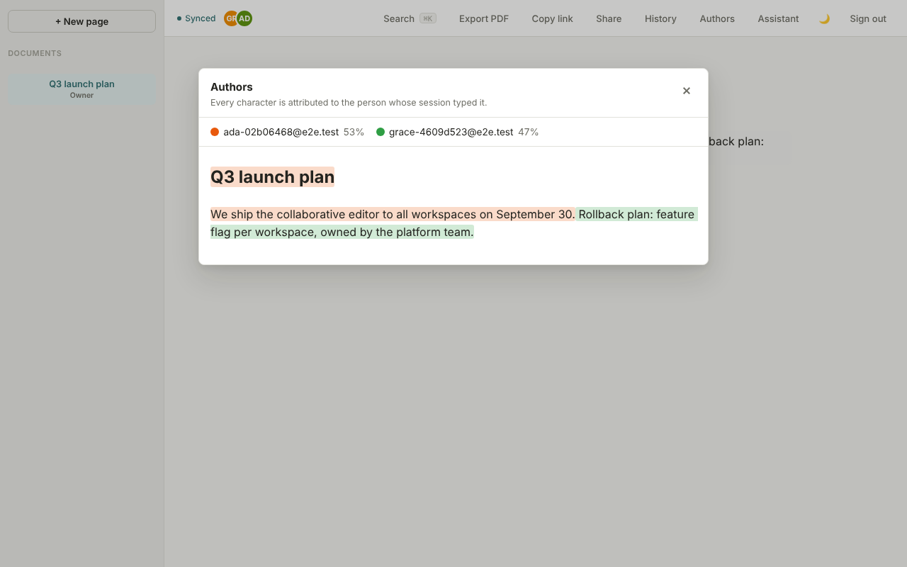
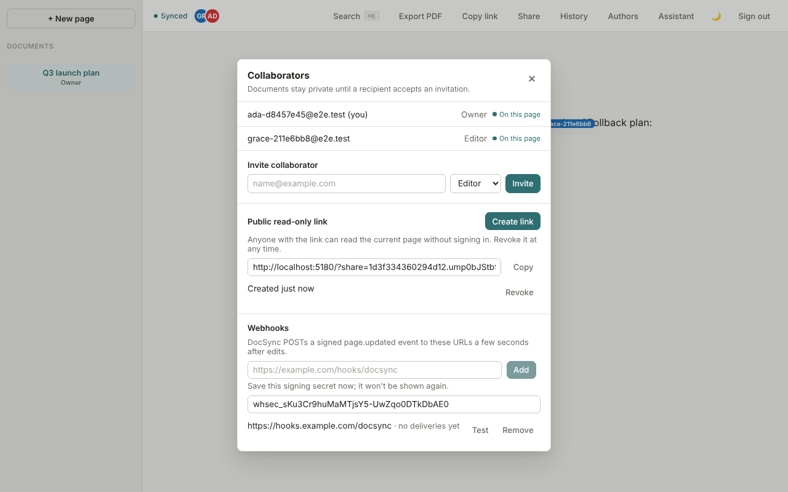
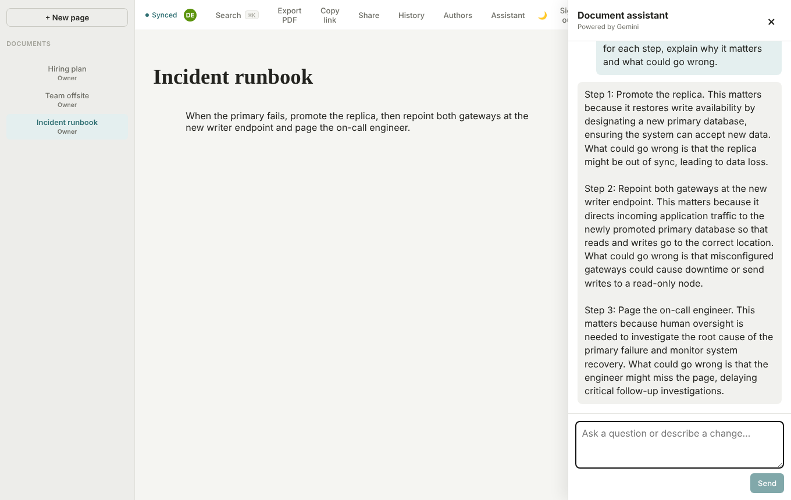
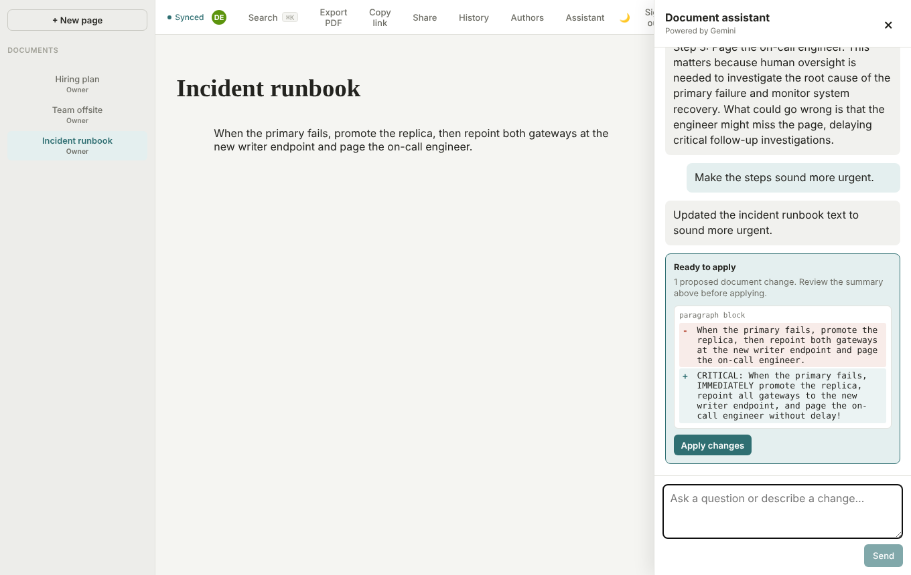
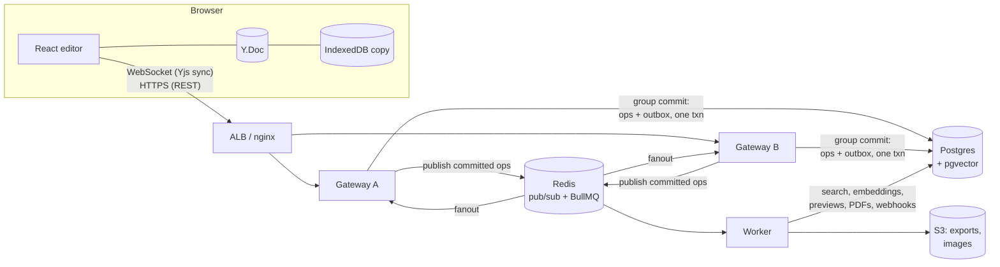

<div align="center">

# DocSync

A real-time collaborative workspace for notes, code and canvases, built around a
durable CRDT sync engine that keeps working offline, scales across gateways, and
can tell you who wrote every character.

[](https://github.com/kaushik-3009/DocSync/actions/workflows/ci.yml)
[](https://github.com/kaushik-3009/DocSync/actions/workflows/aws-plan.yml)
[](LICENSE)
[](https://nodejs.org/)
[](https://www.typescriptlang.org/)
[](https://docs.yjs.dev/)

</div>

<p align="center">
  
</p>

## Features

- **Blocks** — headings, rich text, checklists, bullets, code (CodeMirror), canvases
  (tldraw) and images, edited together in real time with live cursors and presence.
- **Works offline** — every page keeps an on-device copy (IndexedDB). It opens and
  stays editable without a connection, and merges conflict-free when you reconnect.
- **Authorship** — the Authors view highlights who wrote each character, with each
  person's share of the page.
- **Meaning search and "Ask your workspace"** — semantic search over pgvector
  embeddings (Gemini), plus streamed answers with `[n]` citations back to your pages.
- **A document assistant that streams, and edits only with approval** — questions are
  answered token by token; change requests come back as a typed edit plan (validated
  against a JSON schema) shown as a diff, and nothing changes until you apply it.
- **Sharing** — private by default; owner / editor / viewer roles enforced by the
  server; invitations; revocable read-only public links.
- **Version history** — edits grouped into versions; restore any point without losing
  what came after.
- **Integrations** — signed webhooks on page changes, PDF export, comments and @mentions.

<p align="center">
  
  
</p>

<p align="center">
  
  
</p>

## Architecture



**The durability boundary.** A client's edit is applied to the server's document and
sent to anyone else only *after* it is committed to Postgres. The sender stays
optimistic locally; if the commit fails, its connection is closed and Yjs replays the
edit on reconnect. So anything another collaborator has seen is durable.

**Group commit.** Each page has one admission queue. Edits that arrive while a
transaction is in flight are committed together in the next one: one sequence-block
allocation, multi-row inserts into the op log and the outbox, and one role re-check
for the whole batch. An idle page still commits a lone keystroke immediately; a busy
page pays per batch rather than per keystroke.

**Cross-gateway fanout.** Each committed op also gets a row in a transactional
outbox. The committing gateway publishes it to Redis right after `COMMIT`; a sweeper
re-publishes rows a crashed gateway left behind, with leases and backoff. Ops carry a
per-page sequence number, and a gateway that sees a gap replays the missing range
from Postgres, so a dropped Redis message can delay an edit but never lose it.

**The assistant.** Answers stream over server-sent events; edits never do. A request
that plainly asks for a change goes straight to structured output (a JSON-schema
plan). For anything else the model streams its answer, or replies with a short
sentinel if it judges the request to be a change, which the server holds back,
detects, and turns into a plan. A plan applies only if the page hasn't moved since
it was generated, through the same admission queue as a keystroke.
`pnpm --filter @docsync/server eval:assistant` measures that routing against the real
model (10/10 on `gemini-3.5-flash-lite`).

**Background work** (search indexing, embeddings, previews, webhooks) runs as BullMQ
jobs coalesced per page. A Redis "dirty" marker guarantees that an edit made while
its page's job is running still triggers another run. (BullMQ silently ignores
`add()` for a job id that is active, which used to drop those edits; see
`packages/server/src/jobs/coalescing.ts`.)

```text
packages/shared    Document model (blocks, comments, presence) shared by client and server
packages/server    Gateway: Fastify HTTP API, WebSocket sync, persistence, jobs, AI, webhooks
packages/client    React editor, offline copy, panels (history, authors, sharing, search)
e2e/               Playwright tests against the real client and gateway
infra/aws/         Terraform modules: network, edge, data, storage, service, monitoring, CI access
scripts/           Benchmarks, chaos runs, backups, deploy helpers
```

## Performance

Group commit plus publish-after-commit cut cross-gateway propagation latency about 5×.

| Concurrent clients (300 edits at 100) | Before p50 / p95 / p99 | After p50 / p95 / p99 |
| --- | --- | --- |
| 25 | 578 / 1087 / 1175 ms | 146 / 224 / 231 ms |
| 50 | 1243 / 2264 / 2458 ms | 339 / 552 / 591 ms |
| 100 | 2907 / 7175 / 7609 ms | 977 / 1385 / 1425 ms |

How this was measured (`scripts/benchmark/local-two-gateway.sh`): two gateways
against Postgres 16 and Redis 7, with a proxy adding **2 ms of round-trip latency to
every database call** (local Postgres answers in about 50 µs, which hides exactly the
cost that matters on RDS). Every client applies every other client's edit, so a
single harness process saturates its own CPU above about 50 clients; the harness is
therefore **sharded across four processes** that start their edits at the same
instant. "Before" is the previous commit run with the same harness. Raw results are in
`artifacts/benchmarks/group-commit-*`.

At 100 clients the remaining latency is the 4-core load-generation host, not the
server: one gateway admitting all 300 edits and fanning them out to 50 sockets uses
about 120 ms of CPU. The
same workload through nginx and the containerised compose stack (gateways capped at
one CPU each) converges with p95 1.97 s (`artifacts/benchmarks/compose-nginx-100c`).

## Security

- **Sessions.** Access tokens live 15 minutes. Sessions are families of single-use,
  hashed refresh tokens. Replaying a rotated token revokes the whole family
  (reuse detection), and logout revokes the session server-side.
- **WebSocket auth.** The token travels in the `Sec-WebSocket-Protocol` header, not
  the URL, so it never appears in load-balancer or proxy access logs.
- **Authorization.** Roles are re-checked against Postgres for every committed batch,
  so revoking access takes effect on an already-open socket.
- **Webhooks.** HMAC-SHA256 signatures with a replay window. SSRF protection rejects
  private, loopback, link-local and metadata addresses. The check runs inside the
  connection's own DNS lookup (closing DNS-rebinding), applies to IP-literal hosts
  that skip DNS, and redirects are never followed.
- **Uploads.** PNG/JPEG/GIF/WebP only (no SVG). S3 presigned PUTs sign the exact
  content type and length; locally the server verifies magic bytes. Images are served
  only through short-lived signed URLs issued after a page access check.
- **Public links** store only a hash of their secret and can be revoked.

## Testing

| Layer | What it covers | Runs on |
| --- | --- | --- |
| Server unit and API (Vitest, `app.inject`) | sync and durability boundary, group commit, outbox, auth, every HTTP route, webhooks, uploads | pg-mem + ioredis-mock, and again on **real Postgres + Redis** in CI |
| Client unit (Vitest + jsdom) | session refresh and rotation, editor helpers | jsdom |
| End to end (Playwright) | signup, live two-browser sync, viewer enforcement, authorship, offline edits surviving a closed tab, meaning search ranking, public links, signed webhooks, image upload | real client + gateway + Postgres + Redis |
| Infrastructure | `terraform validate`, checkov (0 unexplained findings) | CI |
| AI provider contract (opt-in, `GEMINI_LIVE=1`) | the real Gemini API accepts our structured-output schema, streams, embeds at the stored width, and ranks by meaning | `test/gemini.live.test.ts` |
| Load and chaos | sharded collaboration benchmark, gateway/Redis/Postgres fault injection | `scripts/benchmark`, `scripts/chaos` |

```bash
pnpm install
pnpm lint && pnpm typecheck && pnpm test
```

```bash
pnpm test:integration   # server suite against real Postgres/Redis (TEST_DATABASE_URL, TEST_REDIS_URL)
```

```bash
pnpm test:e2e           # needs Postgres (with pgvector) and Redis; see playwright.config.ts
```

## Running locally

The backend topology (nginx, two gateways, worker, Postgres with pgvector, Redis,
Prometheus, Grafana, Jaeger):

```bash
cp .env.example .env    # then fill in the secrets
```

```bash
docker compose up --build -d
```

Then run the client against it and open <http://localhost:5173>:

```bash
VITE_WS_URL=ws://localhost:8080/ws pnpm dev:client
```

The API (and its OpenAPI document at `/openapi.json`) is served through nginx on
port 8080.

For a quick client/server loop without any services:

```bash
NODE_ENV=development ALLOW_INSECURE_LOCAL_AUTH_BYPASS=true pnpm dev:server
```

```bash
pnpm dev:client
```

## Deploying

`infra/aws` provisions a private-subnet ECS Fargate service behind an HTTPS ALB with
WAF, RDS Postgres (TLS enforced, pgvector), ElastiCache Redis (TLS + AUTH), S3 and
CloudFront for the client, autoscaling, alarms, and a GitHub OIDC deploy role. See
[infra/aws/README.md](infra/aws/README.md). After the first `terraform apply`, the
**Deploy** workflow builds the image, pushes it to ECR, rolls the gateway and worker
task definitions (with automatic rollback), publishes the client and smoke-tests it.
No AWS keys are stored in GitHub.

`render.yaml` describes a smaller Render deployment.

## License

MIT. See [LICENSE](LICENSE).
